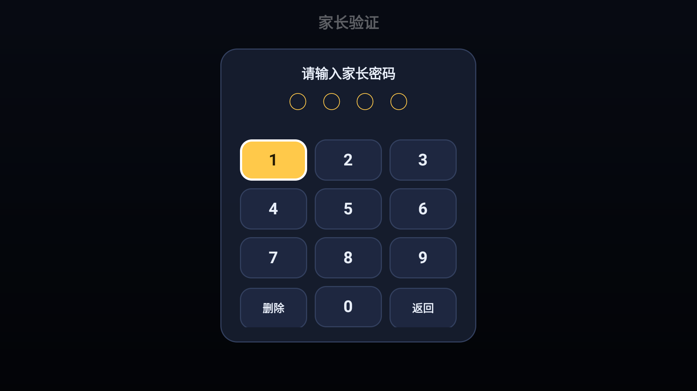
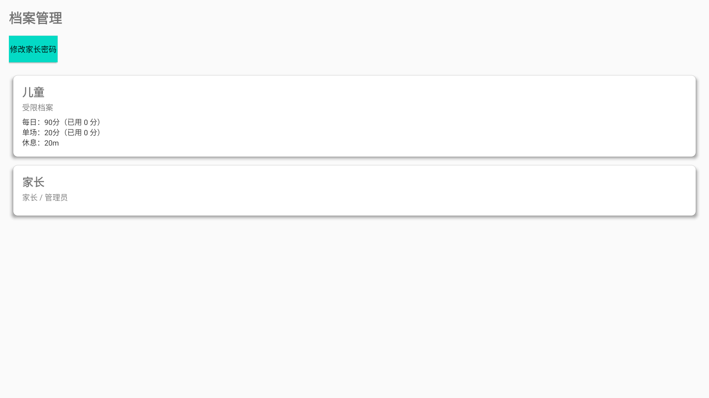
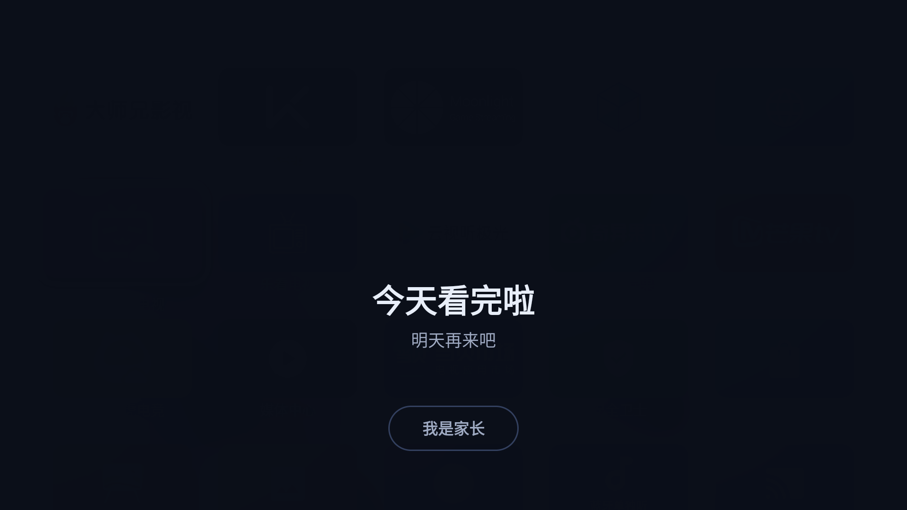

# 电视时间管家（中文改造版）

给 Android TV / 电视盒子用的**儿童观看时间管理**：每天能看多少分钟、一次最多看多久、到点必须休息多久，全部由家长设定。到点后画面直接跳回桌面并显示大号倒计时，孩子自己就知道还要等多久。

本项目基于 [aleung/tv-usage-limit](https://github.com/aleung/tv-usage-limit)（作者 Leo Liang，Apache-2.0）改造，界面全中文，并修掉了原版在国内电视（TCL 等）上「到点不拦」「装完不生效」等一系列问题。


---

## ⚠️ 先说明：这是改造版，不是原版

| 项目 | 说明 |
|---|---|
| 上游项目 | [aleung/tv-usage-limit](https://github.com/aleung/tv-usage-limit) |
| 原作者 | Leo Liang \<leoliang@gmail.com\> |
| 开源协议 | Apache License 2.0（保留原作者版权声明，本仓库的修改同样以 Apache-2.0 发布） |
| 包名 | `com.example.tvlimit`（与上游一致，安装前请先卸载原版） |
| 当前版本 | `2.5.26-cn`（versionCode 36） |
| 改动范围 | 界面中文化 + 前台判定重写 + 拦截页重做 + 应用级限制 + TCL 适配（见下方[改动清单](#相对上游的改动清单)） |

本项目不是在原版上做皮肤替换，核心的「判断现在前台是哪个应用」和「怎么拦住它」这两段逻辑被重写过，因为原版在国产电视上会失效。

---

## 它能做什么

| 功能 | 说明 |
|---|---|
| 双档案 | **儿童**（受限）/ **家长**（不限）。切到家长档案需要密码 |
| 每日额度 | 一天累计最多看多少分钟，用完当天不再放行 |
| 单场额度 | 一次连续最多看多久（例如 20 分钟） |
| 强制休息 | 单场到点后必须休息 N 分钟才能再看 |
| 应用级限制 | 只限制勾选的几个应用（如视频 App），其它应用不受影响；也可以「不限应用」= 整机限时 |
| 剩余时间角标 | 桌面右上角显示「还剩 18 分」，可关 |
| 到点拦截 | 全屏提示 + 自动退回桌面 + 「还 要 休 息 X 分 XX 秒」实时倒计时 |
| 家长入口 | 拦截页上的「我是家长」可输密码切档案，不用摸黑找遥控器 |

<table>
<tr>
<td></td>
<td></td>
</tr>
<tr>
<td align="center">桌面右上角：还剩 18 分</td>
<td align="center">屏保状态也在计时</td>
</tr>
</table>

---

## 安装

### 下载

到 [Releases](../../releases) 下载最新的 `tvlimit-*.apk`（debug 签名，个人家庭使用足够；要上架或分发请自己用正式证书重签）。

要求：Android 8.0（API 26）以上，Android TV / Google TV / 电视盒子均可。

### 方式一：U 盘安装

把 APK 拷到 U 盘 → 插到电视 → 用电视自带的「文件管理 / 媒体中心」找到它 → 确认安装。

### 方式二：ADB 安装（推荐，方便后续升级）

```bash
adb connect <电视IP>:5555     # 先在电视「开发者选项」里打开 ADB 调试
adb install -r tvlimit-2.5.26-cn.apk
```

> **国产电视的坑**：TCL 等机型的固件会拒绝一切 `adb install`，报 `INSTALL_FAILED_VERIFICATION_FAILURE`。这时改用电视自带的「多屏互动 / 应用推送」从手机或电脑推送安装，或者直接 U 盘装。

### 方式三：自己编译

需要 JDK 17 与 Android SDK（platform 34 / build-tools 34.0.0）：

```bash
git clone <this-repo>
cd tv-usage-limit-cn
export JAVA_HOME=/path/to/jdk-17
export ANDROID_HOME=/path/to/android-sdk
./gradlew assembleDebug
# 产物：app/build/outputs/apk/debug/app-debug.apk
```

---

## 首次运行必须做的三件事

装完直接打开是不会生效的，必须授权。缺任何一项，限制都会「看起来开了、其实没人管」。

1. **使用情况访问权限**（必须）
   电视「设置 → 应用 → 特殊权限 → 使用情况访问」里允许本应用。
   没有它，程序无法知道当前前台是哪个应用，应用级限制和到点拦截都不会工作。

2. **悬浮窗权限 / 显示在其他应用上层**（必须）
   用于显示剩余时间角标和全屏拦截页。

3. **设备管理权限**（可选）
   授权后到点会自动关屏。国产电视（尤其 TCL）会隔一段时间自动撤销这个权限，撤销后只是不关屏，拦截提示照常出现。

建议顺手把本应用加入「电池优化白名单 / 自启动白名单」，否则系统可能把计时服务杀掉。

---

## 使用教程

### 1. 进家长设置

应用主界面点「家长设置」，输入密码（首次进入请先自己改一次密码）。



> 密码用遥控器九宫格输入，不需要软键盘 —— 原版用系统输入框，电视遥控器根本没法把焦点移进输入框，会直接把家长卡在门外。

### 2. 编辑儿童档案



在「档案管理」里选**儿童**档案，设置三件事：

| 项目 | 建议值 | 含义 |
|---|---|---|
| 每日上限 | 90 分钟 | 一天总共能看多久，用完当天锁定 |
| 单场上限 | 20 分钟 | 一次连续最多看多久 |
| 休息时长 | 20 分钟 | 单场到点后必须休息多久 |

家长档案不用设置，切过去就不受限。

### 3. 选择要限制的应用

在档案设置里点「限制应用」：

- **勾选几个 App** → 只有这些 App 受限制，几个 App **共享**同一份额度（比如 20 分钟）
- **不勾选（不限应用）** → 整机限时：只要电视在使用就计时

两种模式切换时的计时规则（很重要，避免孩子被白关）：

| 切换方向 | 今日已用时长 |
|---|---|
| 整机 → 只限几个应用 | **清零重新算**（整机口径的分钟数不能等同于应用口径） |
| 只限几个应用 → 整机 | **沿用，不清零** |
| 应用列表里增删应用 | 沿用，不清零 |

### 4. 到点之后会发生什么

1. 单场额度用完 → 播放暂停，弹出拦截页，10 秒后尝试关屏
2. 进入休息态，页面中间显示 **还 要 休 息 X 分 XX 秒**，每秒递减
3. 画面自动退回桌面，孩子切去看允许的应用（比如戏曲 App）时拦截页自动撤掉，不会一直压着
4. 休息结束 → 本场计时清零，可以继续看

日额度用完时是另一套提示：



### 5. 临时关闭

家长设置里有「临时关闭限时」，关掉后不计数、不拦截，桌面角标会显示「限时已关闭 N 分」，避免忘了还关着。

---

## 相对上游的改动清单

原版是一个结构清晰的开源项目，但在国产电视上会因为系统行为差异而失效。以下是逐条修复：

### 中文化

- 全部布局、字符串、Toast、动态文案改中文；档案名 `Child/Parent` → `儿童/家长`
- 新增遥控器可操作的九宫格密码控件（`PinPadDialog`），替换三处系统输入框
- 去掉主界面上印着「默认 PIN 1234」的提示

### 到点不拦（核心 bug，两层原因）

| 问题 | 现象 | 修法 |
|---|---|---|
| 前台判定用「最近 60 秒内时间戳最大的 resume 事件」 | 刚打开应用能拦；连续看一分钟后系统不再产生事件 → 判定为「不知道在前台」→ 到点不拦 | 改为 **resumed 栈** + 增量事件游标，栈顶即前台 |
| TCL 皮肤层 `com.tcl.walleve` 会跟着视频一起 resume | 时间戳比视频 App 还新 → 判定成「前台是皮肤」→ 不在受限集合 → 不拦 | 把系统 UI / 皮肤层当**透明包**跳过 |

### 拦截页被视频画面盖住

现象：到点只把片子暂停了，遮罩没出来，按一下遥控器才出现。
原因：TCL 播放时视频走独立硬件层，压在普通应用窗口之上，后台 `startActivity` 拉起的拦截页虽然 resume 了但看不见。
修法：拦截页改成 **全屏悬浮窗**（`TYPE_APPLICATION_OVERLAY`），挂上之后再主动退回桌面释放视频层。

配套细节：

- 最短显示 8 秒（否则被系统拉回上一个应用时提示只闪一下）
- 1 秒心跳自愈：窗口被系统摘掉会自动补回、额度恢复自动撤、焦点丢失重新抢回

### 装完新版本后完全不生效

```
FreezeManager: doFreeze <pid> pkg com.example.tvlimit status: HighUsedApp, FreezeApp
```

TCL 的 `FreezeManager` 会在进程起来约 6 秒后冻结它，`startForegroundService` 的请求永远不执行（`dumpsys` 里连 ServiceRecord 都没有），限额和拦截**全部失效且毫无征兆**。

修法：新增透明的 `WakeupActivity`，开机广播 / 覆盖安装 / 15 分钟看门狗发现服务没跑时，用它把应用短暂顶到前台再启动服务（有可见 Activity 的进程不会被判成可冻结）。

### 应用级限制与口径规则

原版只有「整机限时」。现在可以只限制勾选的应用，并明确了两套口径切换时今日用量怎么处理（见上方表格），避免「改一下设置，孩子额度突然被清空或突然被关」。

### 其它修复

- 状态持久化节流，但进程被杀时强制落盘（原来会丢「本场已看多少分钟」，孩子重启后白拿一次额度）
- 休息到期同时清本场分钟数；恢复时若发现「已满额但没有休息在进行」的残留状态，视为脏数据清零
- 监控协程把协程取消当错误记日志的问题
- 跨线程读写的关键字段加 `@Volatile`
- 修复 `AppDatabase` 首次初始化并发导致的重复建档

---

## 已知限制

- **TCL 的冻结策略仍在**：如果看门狗也被冻结、又一直没人打开本应用，最长可能有 15 分钟的空窗（`JobScheduler` 周期下限就是 15 分钟）。日常使用有前台服务 + 开机自启，实际影响很小。
- **设备管理权限会被国产电视撤销**：撤销后到点不会真的关屏，只会弹拦截页并暂停播放。
- **debug 签名**：本项目发布的是 debug 构建，方便用 `run-as` 调试。正式分发请自行配置签名。
- 整机模式与「仅限应用」模式用的是两套界面，大数字休息页在整机模式下出现。

---

## 调试

```bash
adb logcat TvLimit:V *:S        # 只看本应用日志
adb shell dumpsys activity services com.example.tvlimit
```

排查「明明该拦却没拦」时，先确认服务在跑：

```bash
adb shell dumpsys activity services com.example.tvlimit | grep -E 'isForeground|startForegroundCount'
```

`startForegroundCount=0` 说明服务只创建了记录、从未真正运行 —— 这是「装完不生效」的典型症状。

---

## 致谢与许可

- 原项目：[aleung/tv-usage-limit](https://github.com/aleung/tv-usage-limit)，作者 Leo Liang
- 本改造版遵循 [Apache License 2.0](LICENSE)，保留原作者的版权声明，修改部分同样以 Apache-2.0 发布
- 详细改动声明见 [NOTICE](NOTICE)

```
Copyright 2026 Leo Liang <leoliang@gmail.com>
Modifications Copyright 2026 tv-usage-limit-cn contributors

Licensed under the Apache License, Version 2.0 (the "License");
you may not use this file except in compliance with the License.
You may obtain a copy of the License at

    http://www.apache.org/licenses/LICENSE-2.0
```

如果你也在国产电视上踩到类似的坑，欢迎提 issue 或 PR。
