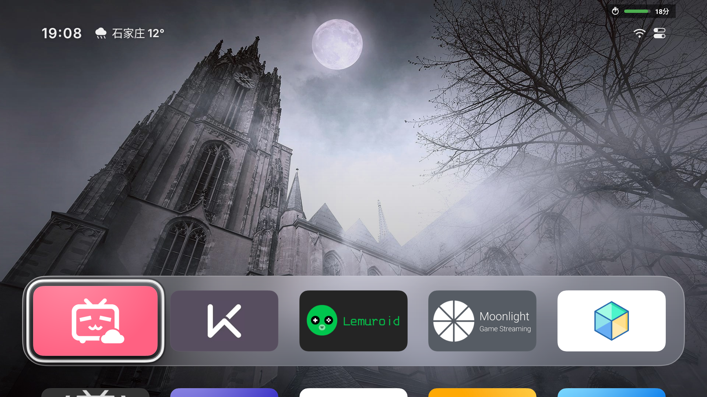

# tv-usage-limit-cn

[](LICENSE)
[](#环境要求)
[](https://github.com/aleung/tv-usage-limit)

Android TV / 电视盒子上的**儿童观看时间管理**：家长设定每日额度、单场额度和强制休息时长，到点后自动暂停播放、退回桌面并显示剩余休息时间的倒计时。

本项目是 [aleung/tv-usage-limit](https://github.com/aleung/tv-usage-limit) 的中文改造版，界面全中文，并修复了原版在国产电视（TCL 等）上「到点不拦」「装完不生效」等问题。


---

## 功能

- **双档案**：儿童（受限）/ 家长（不限），切换到家长档案需要密码
- **每日额度**：一天累计上限，用完当天不再放行
- **单场额度**：一次连续观看的上限，到点强制休息
- **应用级限制**：只限制勾选的应用，其余应用照常使用；不勾选则为整机限时
- **答题门禁**：每看一段时间弹一组题，全答对才能接着看（间隔、题量、年级、科目可配）
- **手机扫码配置**：电视上显示一个二维码，手机扫一下就能改**所有**设置 —— 额度、作息、答题参数、题库、错题、家长密码（2.8.0 起）
- **在家外面也能改（可选）**：默认只允许同一个 WiFi；打开「允许远程」后，配合 Tailscale / ZeroTier 这类点对点组网即可，不需要公网服务器、不用改路由器（2.8.0 起）
- **临时加时 / 暂停**：手机上点 +15 / +30 / +60，只加今天、明天自动归零；家长自己看可以暂停 30 分钟 / 1 小时 / 关到今晚（2.8.0 起）
- **作息时段**：只在设定的时间段里能看，工作日和周末分开配、最多 3 段、支持跨夜（如 21:00-07:00）（2.8.0 起）
- **学习周报 + 错题本**：近 7 / 30 天用量曲线、答题正确率、被拦次数、错得最多的题和正确答案（2.8.0 起）
- **题库缺口矩阵**：科目 × 年级一张表，直接看出哪一块题不够（2.8.0 起）
- **剩余时间角标**：悬浮在桌面右上角的「还剩 N 分」，可关闭
- **全屏拦截页**：暂停播放、退回桌面，显示「还 要 休 息 X 分 XX 秒」并逐秒递减
- **家长入口**：拦截页上的「我是家长」可直接输密码切换档案
- **遥控器可操作**：所有输入（含密码）都支持方向键 + 确认键，不依赖软键盘

<table>
<tr>
<td></td>
<td></td>
</tr>
<tr>
<td align="center">桌面右上角：还剩 18 分</td>
<td align="center">屏保状态也在计时</td>
</tr>
</table>

---

## 环境要求

- Android 8.0（API 26）及以上，Android TV / Google TV / 电视盒子
- 「使用情况访问」权限（必需）
- 「悬浮窗 / 显示在其他应用上层」权限（必需）
- 「设备管理」权限（可选，仅用于到点自动关屏）

---

## 安装

### 方式一：下载 APK

到 [Releases](../../releases) 下载最新的 `tvlimit-*.apk`。把 APK 拷到 U 盘，插到电视，用电视自带的文件管理器安装。

> 发布物为 **debug 签名**，个人家庭使用足够；如需分发请自行用正式证书重签。

### 方式二：ADB

```bash
adb connect <TV_IP>:5555     # 先在电视「开发者选项」里打开网络调试
adb install -r tvlimit-2.7.6-cn.apk
adb shell am start -n com.example.tvlimit/.ui.MainActivity   # 装完必须启动一次
```

部分国产电视固件会拒绝 `adb install`（`INSTALL_FAILED_VERIFICATION_FAILURE`），此时改用电视自带的「多屏互动 / 应用推送」，或直接用 U 盘安装。
TCL 等机型的完整绕过流程（临时停用 `com.android.packageinstaller` 再装）写在 [docs/HANDOVER.md](docs/HANDOVER.md) 第 3 节。

**装完一定要 `am start` 一次**：被 force-stop 过的包处于 stopped 状态，看门狗不会自动运行，服务起不来等于限额失效。

**如果已装过上游原版，请先卸载** —— 包名相同（`com.example.tvlimit`）但签名不同：

```bash
adb uninstall com.example.tvlimit
```

### 方式三：从源码构建

需要 JDK 17 与 Android SDK（platform 34 / build-tools 34.0.0）：

```bash
git clone https://github.com/hw7622/tv-usage-limit-cn.git
cd tv-usage-limit-cn
export JAVA_HOME=/path/to/jdk-17
export ANDROID_HOME=/path/to/android-sdk
./gradlew assembleDebug
# 产物：app/build/outputs/apk/debug/app-debug.apk
```

---

## 首次启动

装完直接打开不会生效，必须先授权，缺任何一项都会「看起来开了、其实没人管」：

1. **使用情况访问权限**（必需）
   设置 → 应用 → 特殊权限 → 使用情况访问 → 允许本应用。
   没有它无法判断当前前台应用，应用级限制与到点拦截都不会工作。
2. **悬浮窗权限**（必需）
   用于显示剩余时间角标与全屏拦截页。
3. **设备管理权限**（可选）
   授权后到点自动关屏。国产电视会周期性撤销该权限，撤销后仅不关屏，拦截照常。

建议同时把本应用加入系统的「电池优化白名单 / 自启动白名单」，否则计时服务可能被系统回收。

默认家长 PIN 为 `1234`，首次进入家长设置后请立即修改。

---

## 配置说明

家长设置中可以编辑每个档案的三项参数：

| 参数 | 说明 |
|---|---|
| 每日上限 | 一天累计可观看时长，用完当天锁定 |
| 单场上限 | 一次连续可观看时长，到点进入休息 |
| 休息时长 | 单场到点后必须休息的时长 |

「限制应用」页决定计时范围：

- 勾选若干应用 → 只有这些应用受限制，且**共享**同一份额度
- 一个都不勾选 → 整机限时，屏幕在使用即计时

切换口径时今日用量的处理规则：

| 切换方向 | 今日已用时长 |
|---|---|
| 整机 → 仅限应用 | 清零重新计算（两种口径不可换算） |
| 仅限应用 → 整机 | 沿用，不清零 |
| 应用列表增删 | 沿用，不清零 |

---

## 答题门禁

除了按时间硬性拦截，还可以要求孩子**答对题才能接着看**。默认关闭，在家长设置里打开。

### 规则

- 每看够设定的间隔（默认 **10 分钟**）弹**一组题**，默认 **3 道**
- 一组必须**全部答对**才放行，答完回到原来正在看的应用
- 答错：错 1 次追加 1 道、错 2 次追加 2 道……单次最多追加 5 道，错满 2 次给出正确答案和解析
- 到点该休息、或当天额度用完时，**休息优先**，不再弹题
- 提醒一次后不答完就跑，下次打开应用会立刻重新弹（`quiz_pending`），坐在桌面不会被反复糊脸

### 可配项

家长设置 →「答题门禁」：

| 配置 | 默认 | 可选 |
|---|---|---|
| 开启答题 | 关 | 开 / 关 |
| 每隔多久答一组 | 10 分钟 | 5 / 10 / 15 / 20 / 30 / 45 分钟 |
| 每次答几道题 | 3 道 | 1–6 / 8 / 10 道 |
| 题目年级 | 二年级 | 一年级 – 初三 |
| 出题科目 | 数学、语文、英语 | 数 / 语 / 英 / 科 / 物 / 化 / 生 / 史 / 地 / 道法，可多选 |

几个刻意做的取舍：

- **间隔不能超过单场额度太多**：若间隔 ≥ 单场额度，到点时 `isLimitReached()` 会先命中，题永远弹不出来。
  程序把触发点兜底为 `min(间隔, 单场额度 × 80%)`，保证休息前一定能弹出。
- **数学不入题库**：按年级即时生成（进位加法、退位减法、表内乘法等），题量无限且不会撞题。
- **题量越大、答错的追加题也越多**，一组 10 道时最坏可能累积 20 道以上，建议小学低年级用 2–3 道。

### 题库

内置 **134 道自编题**，覆盖小学语文/英语/科学与初中的物化生史地政（数学走生成器）。
**题量仍然偏少**：默认配置下一天约需 54 道，二年级语文 38 道，一周多就转完一圈。

题库走「自编为主」的路子：题目由项目自己编写，数据随源码一起以 Apache-2.0 发布，
不打包任何第三方题库——那些源只作为**参考和扩展方向**列在路线图里，需要的人自己下载、自己转。

想自己加题、或者把别的题库导进来：

```bash
# 导出成表格，在 Excel / WPS 里编题
python tools/import_bank.py export app/src/main/assets/quiz/bank.json -o 题库.csv
# 改完转回去，打散答案位置，再合并（自动校验、去重、编号）
python tools/import_bank.py convert 题库.csv -o tmp/new.json --source 自编
python tools/import_bank.py rebalance tmp/new.json
python tools/import_bank.py merge app/src/main/assets/quiz/bank.json tmp/new.json \
    -o app/src/main/assets/quiz/bank.json
# 体检：题量矩阵、缺口、非法题
python tools/import_bank.py check app/src/main/assets/quiz/bank.json
```

格式规范、字段约束、第三方题库的映射写法与四个常见坑，见 [docs/QUIZ_FORMAT.md](docs/QUIZ_FORMAT.md)。

> **正确答案别总放第一格。** 第一版题库 96% 的答案是 A，孩子一路按左键就能过；
> 已用 `rebalance` 打散成 31/28/23/18，`check` 会盯着这个分布。
扩充节奏与家长端「题库管理」的设计，见 [docs/ROADMAP.md](docs/ROADMAP.md)。

---

## 手机配置

电视上开一个很小的网页服务（`ConfigServer`），手机连同一个 WiFi，扫码就能进。**一页改完所有设置**，不用在电视上按遥控器一个个点。

入口：电视首页 → 「手机配置」→ 屏幕上出现二维码。默认端口 8080，扫不出来时屏幕上会直接写地址（`http://192.168.x.x:8080`）。

### 安全边界（四道）

1. **网络层**：白名单制。默认只接受局域网（10/8、172.16/12、192.168/16、169.254/16、IPv6 链路本地）。
   打开「允许远程」只会在白名单里**追加** `100.64/10`（Tailscale）和 IPv6 ULA，
   **公网地址永远 403**——哪怕家里路由器把 8080 映射出去了、哪怕宽带下发了公网 IPv6。
2. **应用层**：所有接口都要先用家长密码换一个内存里的 token（HttpOnly + SameSite=Lax，12 小时过期）。
   同一来源一分钟错 5 次锁 60 秒，且限流按 TCP 真实来源算，**不信 `X-Forwarded-For`**。
3. **浏览器层**：Host 头必须是 IP 字面量（防 DNS rebinding），页面带 CSP（防注入脚本执行）。
4. **数据层**：不读写用户任意文件；导入的题只落在 App 自己的 `filesDir` 里。

另外两件「不用家长操心」的事：关掉电视上的服务后所有 token 立刻失效；
**20 分钟没有任何请求，服务会自动关掉**——家长最容易犯的错不是密码太弱，是开完忘了关。

### 在外面也能改（可选，不需要服务器）

打开「允许非局域网访问」后，来自 `100.64/10`（Tailscale 的 CGNAT 地址）与 IPv6 ULA 的请求会被放行。

做法：电视和手机都装 [Tailscale](https://tailscale.com/)，登录同一个账号 → 电视上会多出一个 `100.x.y.z` 地址 → 手机用这个地址打开（`http://100.x.y.z:8080`）。全程 P2P 直连，不需要公网 IP、不需要端口映射、不需要域名和证书。

**为什么不做「云端中转」**：要么每个家长都得有一台公网服务器（钱 + 门槛），要么我们免费提供一个中转后端 —— 那等于把所有家庭的电视配置放到同一台机器上，还要长期运维、备案、抗攻击。一个「装完断网也能用」的家长控制 App 不该有这种依赖。

**为什么不支持 frp / 端口映射**：这两条路都会让请求从公网 IP 进来，而我们一律拒绝公网来源。
想让电视挂在公网上、只用一个 4 位数字挡着，不是这个项目愿意替你做的选择。
真的要远程，装个 Tailscale 就够了，比配 frp 简单。

### 接口

网页用到的接口都是 `/api/*`，登录后带 cookie 就能用 curl 直接改。完整清单见 [docs/WEB_API.md](docs/WEB_API.md)。

---

## 文档

| 文档 | 内容 |
|---|---|
| [docs/HANDOVER.md](docs/HANDOVER.md) | **换电脑继续开发看这份**：环境搭建、构建、装真机、备份回滚、代码地图、已知坑 |
| [docs/WEB_API.md](docs/WEB_API.md) | 手机配置页的接口清单、鉴权方式、curl 用法、远程访问方案 |
| [docs/QUIZ_FORMAT.md](docs/QUIZ_FORMAT.md) | 题库格式、编题工作流、`tools/import_bank.py` 用法、第三方题库怎么转 |
| [docs/ROADMAP.md](docs/ROADMAP.md) | 待办：题库扩充计划与参考源、题库维护功能设计、真机待验证项 |

---

## 相对上游的改动

### 界面中文化

- 全部布局、字符串、Toast、动态文案改为中文；档案名 `Child/Parent` → `儿童/家长`
- 新增遥控器可操作的九宫格密码控件（`PinPadDialog`），替换三处系统输入框
- 移除主界面上的默认 PIN 提示

### 到点不拦（两层原因）

| 问题 | 现象 | 修法 |
|---|---|---|
| 前台判定依赖「最近 60 秒内时间戳最大的 resume 事件」 | 刚打开能拦；连续播片后系统不再产生事件 → 判定不到前台 → 到点不拦 | 改为 **resumed 栈** + 增量事件游标，栈顶即前台 |
| TCL 皮肤层 `com.tcl.walleve` 随视频一起 resume，时间戳更新 | 前台被判定成皮肤层 → 不在受限集合 → 不拦 | 系统 UI / 皮肤层按**透明包**跳过 |

### 拦截页被视频画面遮挡

现象是到点只暂停了播放，遮罩不出现，按一下遥控器才出来。原因是电视播放时视频走独立硬件层，压在普通应用窗口之上。

改为以 `TYPE_APPLICATION_OVERLAY` 全屏悬浮窗显示，并且挂载后主动退回桌面释放视频层。配套细节：

- 最短显示 8 秒，避免被系统拉回上一个应用时提示只闪一下
- 1 秒心跳自愈：窗口被系统摘除时自动补回，额度恢复时自动撤销，焦点丢失时重新抢回

### 装完新版本后完全不生效

```
FreezeManager: doFreeze <pid> pkg com.example.tvlimit status: HighUsedApp, FreezeApp
```

部分国产固件的 `FreezeManager` 会在进程启动约 6 秒后冻结它，`startForegroundService` 请求永不执行（`dumpsys` 中连 `ServiceRecord` 都没有），限额与拦截全部失效且无任何提示。

修法是新增透明的 `WakeupActivity`：开机广播、覆盖安装、15 分钟看门狗发现服务未运行时，用它把应用短暂顶到前台再启动服务。

### 应用级限制

上游只有整机限时。本版新增「只限制勾选的应用」，并明确了两种口径切换时今日用量的处理规则（见上文表格）。

### 答题门禁（本版新增）

上游没有这个功能。实现上两个关键点：

- **界面是悬浮窗不是 Activity**：电视视频走硬件层，会盖住普通 Activity 窗口，后台 `startActivity` 的页面即使 RESUMED 也看不见。
  用 `TYPE_APPLICATION_OVERLAY` 全屏悬浮窗，配合先挂窗再 `goHome()` 释放视频层，画面才真的换得过来。
- **焦点要补**：窗口刚 `addView` 时还没有 window focus，此时 `requestFocus()` 会「成功但立刻被清掉」，
  表现为题面出来了却没有高亮，孩子以为题目坏了。在 0/80/200/420/800/1400ms 各补一次焦点。

题库与出题规则的现状见上文「答题门禁 → 题库」，扩充计划见 [docs/ROADMAP.md](docs/ROADMAP.md)。

### 其它修复

- 状态持久化节流，进程被杀时强制落盘，避免丢失「本场已看时长」
- 休息结束时同步清空本场分钟数；恢复时如发现「已满额但无休息进行中」的残留状态，视为脏数据清零
- 监控协程把协程取消当作错误记录的日志问题
- 跨线程读写的关键字段加 `@Volatile`
- `AppDatabase` 首次初始化并发导致的重复建档

---

## 已知限制

- **系统冻结策略仍在**：若看门狗同样被冻结且长期无人打开本应用，最长可能有 15 分钟空窗（`JobScheduler` 周期下限）。日常使用有前台服务与开机自启，影响很小。
- **设备管理权限会被部分固件撤销**：撤销后到点不会真正关屏，只弹拦截页并暂停播放。
- **debug 签名**：发布物使用 debug 构建，便于 `run-as` 调试；正式分发请自行配置签名。
- **两套界面**：整机模式与「仅限应用」模式使用不同布局，大号数字休息页出现在整机模式。

---

## 调试

```bash
adb logcat TvLimit:V *:S                                  # 只看本应用日志
adb shell dumpsys activity services com.example.tvlimit    # 服务状态
```

排查「该拦却没拦」时，先确认服务真的在运行：

```bash
adb shell dumpsys activity services com.example.tvlimit | grep -E "isForeground|startForegroundCount"
```

`startForegroundCount=0` 表示服务只创建了记录、从未真正运行，是「装完不生效」的典型症状。

运行状态也可以从 prefs 读取（debug 构建）：

```bash
adb shell run-as com.example.tvlimit cat shared_prefs/com.example.tvlimit_preferences.xml
```

其中 `s=本场已用 d=今日已用 r=是否到限额 top=当前前台应用 scope=是否在计时范围内`。

---

## 参与贡献

欢迎提交 issue 与 pull request。报告问题时请附上：电视型号、系统版本、`adb logcat TvLimit:V *:S` 的相关片段、以及 `dumpsys activity services` 的输出。

---

## 许可与致谢

- 上游项目：[aleung/tv-usage-limit](https://github.com/aleung/tv-usage-limit)，作者 Leo Liang
- 本项目遵循 [Apache License 2.0](LICENSE)，保留原作者版权声明，修改部分同样以 Apache-2.0 发布
- 修改声明详见 [NOTICE](NOTICE)

```
Copyright 2026 Leo Liang <leoliang@gmail.com>
Modifications Copyright 2026 tv-usage-limit-cn contributors
```
